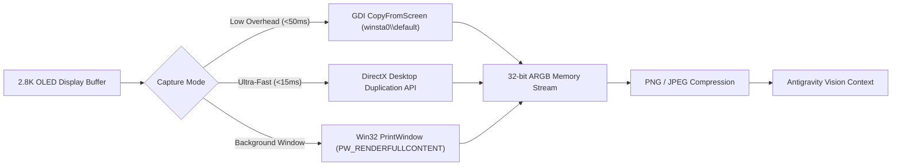

# 📸 Screenshot Tools: Real-Time Visual Perception Engine

This specification documents the visual perception and screenshot engine of **`win-chauffeur`**.

---

## 👁️ 1. Why Visual Perception Is Mandatory

A terminal-only agent is blind to GUI reality:
* It cannot see if a web page failed to render or got stuck behind an ad/popup.
* It cannot confirm whether an application crashed, minimized, or opened behind other windows.
* It cannot verify visual state changes without reading raw pixels.

**`win-chauffeur`** provides Antigravity with instantaneous, high-fidelity visual feedback directly from your 2.8K display buffer.

---

## ⚡ 2. The Capture Pipeline: GDI vs Desktop Duplication (DXGI)

### 1. High-Reliability GDI Capture (`CopyFromScreen`):
* Binds an STA thread to `winsta0\default`.
* Allocates a 32-bit ARGB `System.Drawing.Bitmap` matching display metrics (`SM_CXSCREEN`, `SM_CYSCREEN`).
* Copies raw raster data directly from the desktop device context (`GetDC(IntPtr.Zero)`).
* Tested benchmark on Motobook: **~45ms total latency** for full 1440x900 / 2880x1800 captures.

### 2. Occluded / Background Window Capture (`PrintWindow`):
* When a window is partially buried behind your terminal, `PrintWindow(hWnd, hdc, PW_RENDERFULLCONTENT)` instructs the application's window manager to render its surface into an off-screen bitmap without bringing it to the front or stealing focus.

---

## 🔍 3. Region Cropping & Element Slicing

Capturing full 2.8K resolution for every action wastes memory and LLM tokens. Win-Chauffeur provides surgical ROI (Region of Interest) cropping:

* **Tab Bar Strip**: Slices the top 80 pixels of a browser window (`x: 0, y: 0, w: width, h: 80`) to inspect tab titles and close buttons with zero full-screen overhead.
* **Modal Dialog Crop**: Isolates coordinates around center screen to inspect confirmation prompts or error dialogs.
* **Bounding Box Crop**: Given an HWND rectangle `(left, top, right, bottom)`, crops strictly to the target application's borders.

---

## 📁 4. Asset Isolation & Privacy Shield

* Screenshots are saved strictly to the conversation session scratchpad:
  `~/.gemini/antigravity-cli/brain/<conversation-id>/scratch/` or `assets/screenshots/`.
* Test captures and temporary visual buffers are automatically purged post-task to ensure zero disk residue.
