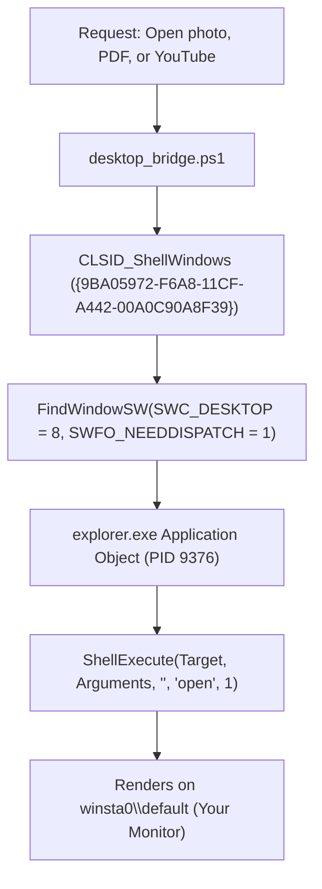

# 🚀 Universal Desktop Launcher & Dispatch Engine

This specification documents the sovereign desktop dispatching engine of **`win-chauffeur`**.

---

## 🏛️ 1. The Sandbox Breakout Invariant

Antigravity executes autonomous tool calls inside an isolated background desktop (`exebox`). Attempting to launch interactive applications directly from this subshell results in:
* **`0xC0000142` (`STATUS_DLL_INIT_FAILED`)**: Windows NT kernel blocks `user32.dll` from binding to `winsta0\default`.
* **Ghost Process Accumulation**: Packaged Modern Apps (UWP/WinUI) like `Photos.exe` launch with `MainWindowHandle = 0` and immediately suspend in the background, corrupting future file associations.

---

## 🛠️ 2. The Out-of-Process Shell COM Bridge

To reliably open files, browsers, and media on Karan's physical monitor, Win-Chauffeur marshals execution through the **Interactive Windows Explorer Desktop Shell**:



### The Production Implementation:
```powershell
$shellWindows = [Activator]::CreateInstance([Type]::GetTypeFromCLSID([Guid]"{9BA05972-F6A8-11CF-A442-00A0C90A8F39}"))
$pvarLoc = [System.Object]0
$pvarLocRoot = [System.Object]0
$pHwnd = 0
$desktopWindow = $shellWindows.FindWindowSW([ref]$pvarLoc, [ref]$pvarLocRoot, 8, [ref]$pHwnd, 1)

if ($desktopWindow -and $desktopWindow.Document -and $desktopWindow.Document.Application) {
    $explorerApp = $desktopWindow.Document.Application
    $explorerApp.ShellExecute($Target, $Arguments, "", "open", 1)
}
```

---

## 🎯 3. Universal File & Media Matrix

Win-Chauffeur dispatches every file type to its authoritative, zero-ghost handler:

| Media Category | File Extensions | Default Target Handler |
| :--- | :--- | :--- |
| **Photos & Images** | `.jpg`, `.png`, `.bmp`, `.webp` | Windows Photos / Classic PhotoViewer / Paint |
| **Documents & PDFs** | `.pdf` | Microsoft Edge / Adobe Acrobat Reader |
| **Music & Sound** | `.mp3`, `.wav`, `.flac`, `.aac` | Default Media Player / .NET `SoundPlayer` |
| **Web & Video Streams** | `https://...`, `youtube.com` | Default Web Browser (Edge / Chrome) |
| **Markdown & Notes** | `.md`, `.txt` | Obsidian / Windows Terminal / Notepad |

---

## 🧹 4. The Zero-Ghost Eradication Protocol

To prevent background ghost accumulation:
1. **Pre-Launch Sanity Sweep**: Before dispatching a new photo or viewer instance, Win-Chauffeur checks for suspended `Photos.exe` or `rundll32` instances with `MainWindowHandle = 0`.
2. **Instant Purge**: If ghost instances exist, it flushes them via `Stop-Process -Name Photos -Force` before launching a fresh interactive instance.
3. **Guaranteed Visibility**: Verifies that the launched process receives a non-zero Win32 window handle on `winsta0\default`.
