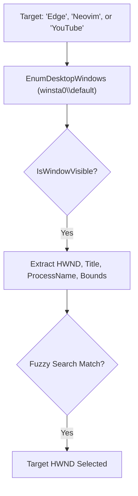

# 🪟 Windows Manager: Layout, Focus & State Engine

This specification documents the master window management subsystem of **`win-chauffeur`**.

---

## 🏛️ 1. Window Discovery & Fuzzy Targeting

A window manager must first accurately locate targets across the desktop hierarchy:



### Identification Primitives:
* **`EnumDesktopWindows`**: Gathers all top-level windows on `winsta0\default`.
* **`GetWindowText`**: Extracts current window title bar strings.
* **`GetWindowThreadProcessId`**: Maps HWND to Process ID (`PID`) and parent process executable (`Name`).
* **`GetWindowRect` / `GetClientRect`**: Retrieves exact outer boundaries `(left, top, right, bottom)` and inner usable canvas.

---

## 📐 2. Window State Transitions (`ShowWindow`)

Win-Chauffeur manipulates window presentation states without glitching:

| Desired State | Win32 Flag | Behavior |
| :--- | :--- | :--- |
| **Minimize** | `SW_MINIMIZE` (`6`) | Sends window to taskbar; frees GPU presentation budget. |
| **Maximize** | `SW_MAXIMIZE` (`3`) | Expands window across the active monitor's work area. |
| **Restore** | `SW_RESTORE` (`9`) | Restores window to its previous floating geometry. |
| **Normal** | `SW_SHOWNORMAL` (`1`) | Activates and displays window in standard mode. |
| **Hide** | `SW_HIDE` (`0`) | Removes window from display and taskbar temporarily. |

---

## 🧩 3. Tiling, Snapping & Dynamic Layouts

Win-Chauffeur provides deterministic programmatic tiling over multi-monitor coordinate grids using `SetWindowPos` / `MoveWindow`:

### Standard Layout Presets:
```text
┌──────────────────────┬──────────────────────┐  ┌──────────────────────────────────────┐
│ Left Half (50%)      │ Right Half (50%)     │  │ Full Work Area (100%)                │
│ X: 0, Y: 0           │ X: Width/2, Y: 0     │  │ X: 0, Y: 0                           │
│ W: Width/2, H: Height│ W: Width/2, H: Height│  │ W: Width, H: Height                  │
└──────────────────────┴──────────────────────┘  └──────────────────────────────────────┘

┌──────────────────────┬──────────────────────┐  ┌──────────────────────────────────────┐
│ Top-Left (25%)       │ Top-Right (25%)      │  │ Centered Float (60% Work Area)       │
├──────────────────────┼──────────────────────┤  │ X: Width*0.2, Y: Height*0.2          │
│ Bottom-Left (25%)    │ Bottom-Right (25%)   │  │ W: Width*0.6, H: Height*0.6          │
└──────────────────────┴──────────────────────┘  └──────────────────────────────────────┘
```

### Coordinate Calculation:
```csharp
[DllImport("user32.dll", SetLastError = true)]
public static extern bool MoveWindow(IntPtr hWnd, int X, int Y, int nWidth, int nHeight, bool bRepaint);
```
* **Taskbar Awareness**: Coordinates dynamically offset based on `rcWork` to ensure windows never clip into the Windows 11 taskbar or floating dock.

---

## ⚡ 4. Z-Order, Always-on-Top & Focus Locking

Control which window sits on top of the visual stack:

* **Always-On-Top (`HWND_TOPMOST = -1`)**:
  ```csharp
  SetWindowPos(hWnd, new IntPtr(-1), 0, 0, 0, 0, SWP_NOMOVE | SWP_NOSIZE);
  ```
  Forces diagnostic monitors, media players, or floating notes to remain pinned over all other applications.
* **Remove Topmost (`HWND_NOTOPMOST = -2`)**:
  Restores standard desktop stacking order.
* **Safe Foreground Activation**:
  Calls `SetForegroundWindow(hWnd)` alongside `BringWindowToTop(hWnd)` to transfer keyboard focus cleanly.

---

## 🛑 5. Graceful vs Forced Termination

* **Tier 1 (Graceful Request)**: Post `WM_CLOSE` (`0x0010`) message to the HWND. Prompts the app to save unsaved documents and close cleanly.
* **Tier 2 (Forceful Eradication)**: If the window hangs or belongs to an uncooperative background ghost, invoke `Stop-Process -Id $pid -Force`.
